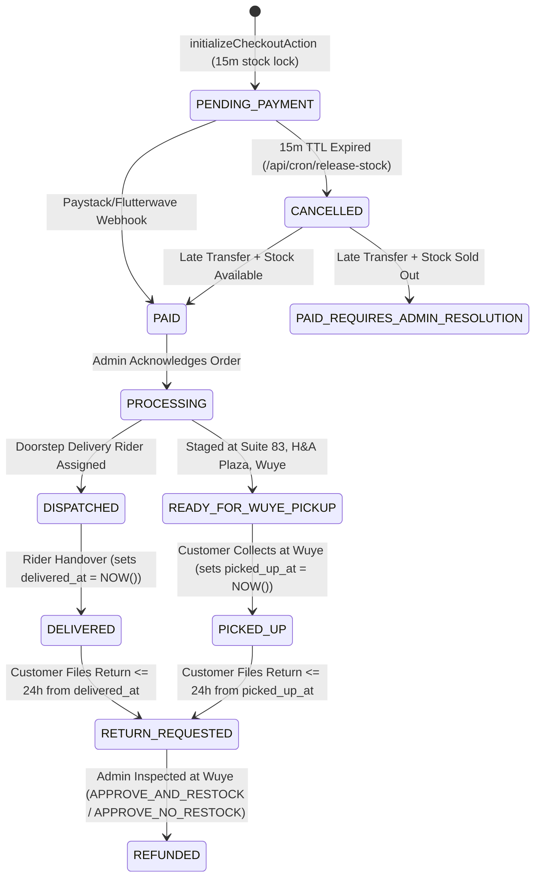

# User Flows, State Machines & Edge-Case Recovery Matrix
**Project:** LifestyleNG.com — Unified Multi-Service Platform  
**Parent Organization:** Lifestyle Corporate Networks Ltd.  
**Priority Level:** CRITICAL (Governs State Transitions Across All 4 Divisions)

## 1. Retail Order Lifecycle & 24-Hour Return State Machine (`/shop/clothes` & MTN Hardware)

### 1.1 Critical Journey: Wuye Click-and-Collect & 24-Hour Return Flow
1. **Discovery & Selection:** Shopper visits `/shop/clothes`, filters by *Clothing*, *Shoes*, *Bags*, or *Accessories*, selects SKU variant (e.g., Size `L` or Shoe `EU 42`), and clicks `Add to Bag`.
2. **Slide-Over Bag & Omnichannel Toggle:** Shopper switches fulfillment in `SlideOverCart` from `Abuja Doorstep Delivery` to `In-Store Pickup — Suite 83 / Block B70, H&A Plaza, Wuye (₦0)`.
3. **Policy Acknowledgment & Zero-Trust Checkout:** On `/checkout`, shopper checks the mandatory box: *"I acknowledge that returns are only accepted within 24 hours of receipt in unworn, original condition."* `initializeCheckoutAction` atomically decrements `available_stock` and increments `reserved_stock` for 15 minutes.
4. **Receipt & 24-Hour Timer Start:** When the shopper collects the package at Suite 83 / Block B70, H&A Plaza, Wuye, the boutique administrator marks the order `PICKED_UP` (`picked_up_at = NOW()`).
5. **Deterministic Return Cutoff:** In `/account/orders`, the `Initiate 24h Return` button displays the exact remaining time (`24h - (NOW() - receiptTimestamp)`). Once `elapsedMs > 86,400,000`, the action deterministically rejects requests with `ERR_RETURN_WINDOW_EXPIRED`.

---

## 2. Lifestyle Boutique (Homes) Flows (`/stays`)

### 2.1 Short-Let vs. Extended Furnished Accommodation Flow
1. Guest visits `/stays` or `/stays/kaura-4-bedroom-luxury-duplex` (Prince & Princess Estate, Kaura District, Abuja).
2. Guest selects stay mode on `StayBookingWidget`:
   - **Nightly Short-Let (`SHORT_LET`):** 1–6 nights charged at `nightlyRateKobo * nightsCount`, or `>= 7 nights` at weekly pro-rata rate.
   - **Furnished Accommodation (`FURNISHED_ACCOMMODATION`):** Extended weekly (`>= 7 nights`) or monthly (`>= 28 nights`) corporate/residential stay applying discounted `weeklyRateKobo` or `monthlyRateKobo`, plus refundable `cautionDepositKobo`.
3. `submitStayBookingAction` locks the property row (`FOR UPDATE`), verifies zero overlap in `stay_blocked_dates`, persists the booking (`LNG-STAY-...`), and returns both online payment initialization and `whatsappConfirmUrl` (`+2348064912969`).

### 2.2 Property & Apartment Management Onboarding Flow
1. Property owner switches the `/stays` segmented control to **Property & Apartment Management**.
2. Submits `PropertyMgmtForm` specifying Abuja district (e.g., Kaura, Guzape, Maitama, Wuye), property type (`DUPLEX`, `APARTMENT`, etc.), bedroom count, furnishing status, and target model (`SHORT_LET_MANAGEMENT`, `CORPORATE_FURNISHED_LEASE`, or `FULL_FACILITY_MANAGEMENT`).
3. `submitPropertyMgmtAction` stores the proposal in `property_management_requests` (`LNG-PM-...`) and opens a pre-filled WhatsApp partnership thread with the Lifestyle Homes management desk.

---

## 3. Lifestyle Logistics Flows (`/car-hire`)

### 3.1 Intra-City Car Hire & 2-Hour Advance Notice Rule
1. Customer selects **Car Hire & Vehicle Rentals** on `/car-hire`, picks a vehicle from the fleet (Executive Sedan, Luxury SUV, Executive Bus), and enters pickup date/time and Abuja route.
2. **2-Hour Advance Notice Check:** If `pickupTimestamp - NOW() < 2 hours (7,200,000 ms)`:
   - The UI displays an amber Apple HIG callout (`--status-warning-bg`): *"We recommend booking at least 2 hours in advance for guaranteed vehicle staging. Urgent dispatch will be prioritized via WhatsApp."*
   - `submitCarHireBookingAction` sets `isUnderTwoHoursNotice = true` on `car_hire_bookings` and generates the **`BOOK A CAR ON WHATSAPP`** deep-link (`+2348064912969`).

### 3.2 Airport Transfers (`ABV`) & Inter-State / Cargo Logistics
- **Airport Transfers:** Selecting `AIRPORT_TRANSFER` reveals the mandatory `Flight Number` field (e.g., `BA083`, `P47120`) and terminal direction (`ABV Airport Pickup -> Abuja City` or `Abuja City -> ABV Airport Drop-Off`).
- **Inter-State & Cargo Logistics:** Customers either book a chauffeur-driven inter-state passenger charter to any of Nigeria's 36 states or switch to the **Cargo & Dispatch Logistics** console (`submitLogisticsShipmentAction`) to generate a tracked waybill (`LNG-WB-...`).

---

## 4. Lifestyle MTN Services Flows (`/mtn-services/fibrex` & `/mtn-fibrex`)

### 4.1 MTN FibreX Unlimited Coverage & Installation Flow
1. Customer visits `/mtn-services/fibrex` (or `/mtn-fibrex`, which `308` redirects to `/mtn-services/fibrex`).
2. Completes `FibrexCoverageCard` with Abuja District/Estate, street address, building type, and service request type (*Coverage Check*, *New Installation*, *Appointment Booking*, or *Subscription Renewal*).
3. Acknowledges the mandatory disclaimer (*"Coverage, installation, speed and service availability are subject to MTN confirmation."*) and clicks **`CHECK FIBREX AVAILABILITY IN MY AREA`**.
4. `submitFibrexEnquiryAction` saves the lead (`LNG-FX-...`) to `fibrex_enquiries` and launches WhatsApp (`+2348064912969`) with the structured FibreX verification template.

### 4.2 MTN Telecom Store & B2B Sales/Distribution Flow
- **Telecom Store:** Customers add MTN 5G/4G Routers, Pocket MiFis, and Outdoor CPEs directly to the shared `SlideOverCart` for immediate online purchase.
- **B2B Sales & Distribution:** Corporate buyers and sub-dealers submit `MtnB2bDistributionForm` (`submitMtnDistributionAction`, `>= 5 units`) to request bulk pricing and fleet provisioning (`LNG-MTNB2B-...`).
